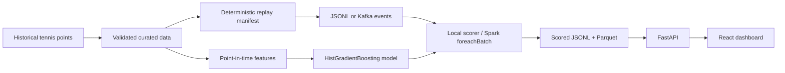

# Centre Court Analytics

**Big Data · Machine Learning · Apache Kafka · Spark Structured Streaming · FastAPI · React**

*A point-by-point tennis analytics platform built as a collaborative academic project.*

This GitHub repository is a **portfolio case study maintained by Akshat Agrawal**. The complete source code, datasets, models, evaluation artifacts, and team commit history are in the **[original Centre Court Analytics team repository](https://github.com/vishaljha2121/big_data_spring_proj)**. This repository documents that work; it does **not** redistribute the original implementation or claim sole authorship.

> **Prediction target:** the probability that Player A wins **the current point**, not a match-win probability, betting odds, or a claim about player misconduct.

[**Explore full source code**](https://github.com/vishaljha2121/big_data_spring_proj) · [**Architecture**](docs/ARCHITECTURE.md) · [**Evaluation and metrics**](docs/RESULTS.md) · [**Demo guide**](docs/DEMO.md)

## Project highlights

| Data | Modeling | Replay / Streaming |
| --- | --- | --- |
| **1,922,136** curated tennis point records | **0.6415** test ROC AUC | **1,917,672** replay events in manifest |
| **10,508** singles matches | **0.2347** test Brier score | **1,000** Kafka/Spark events validated locally |
| **10,464** replay matches | **26** point-in-time-safe model features | **2,454.17 events/sec** local scorer benchmark |

All figures are from the **team's documented experiments**; they have not been rerun in this documentation-only repository. The throughput number measures a local scoring path, **not Kafka/Spark end-to-end production throughput**.

## End-to-end architecture



The original system provides two replay/scoring paths: deterministic **JSONL replay**, and an optional **Kafka → Spark Structured Streaming** path with checkpointing. The FastAPI/React interface uses validated local output rather than presenting itself as a production-hosted streaming service.

## Engineering work demonstrated

| Area | Implementation | Explore team code |
| --- | --- | --- |
| Data engineering | Cleaning, curated points and matches, contracts, Parquet-style layers | [scripts](https://github.com/vishaljha2121/big_data_spring_proj/tree/main/scripts) · [contracts](https://github.com/vishaljha2121/big_data_spring_proj/tree/main/contracts) |
| ML | `HistGradientBoostingClassifier`, match-disjoint splits, 26 safe features | [Model training audit](https://github.com/vishaljha2121/big_data_spring_proj/blob/main/docs/model_training_audit.md) |
| Streaming | Replay producer, Kafka topic, Spark `foreachBatch` scoring | [producer](https://github.com/vishaljha2121/big_data_spring_proj/tree/main/producer) · [spark_streaming](https://github.com/vishaljha2121/big_data_spring_proj/tree/main/spark_streaming) |
| Backend | File-backed FastAPI endpoints for scoring, matches, model metadata | [api](https://github.com/vishaljha2121/big_data_spring_proj/tree/main/api) |
| Frontend | React/Vite dashboard: replay, point timeline, predictions, monitoring | [frontend](https://github.com/vishaljha2121/big_data_spring_proj/tree/main/frontend) |
| Validation | Data contracts, leakage audits, API/frontend checks and tests | [tests](https://github.com/vishaljha2121/big_data_spring_proj/tree/main/tests) |

### Avoiding future-point leakage

The model predicts `label_point_winner_is_player_a` from information available **before** a point is completed. Its match-level train/validation/test splitting keeps entire matches disjoint. An early high-scoring candidate relied on current score-state fields; those fields were excluded before publication. The final reported model has **test AUC 0.6415 on 284,868 held-out points**.

[Read the team's model training audit.](https://github.com/vishaljha2121/big_data_spring_proj/blob/main/docs/model_training_audit.md)

## Reported validation and limitations

- **Local scorer:** 2,454.17 events/sec and p95 latency 0.575 ms/event in the team's benchmark; not a production system result.
- **Kafka + Spark:** 1,000 events scored and validated locally with no invalid records in the published Milestone 5A report.
- **Dashboard:** 9,049 scored events from 50 matches for a responsive local demo; the full replay manifest is much larger.
- **Statistical risk signals:** anomaly indicators for review, not proof of match-fixing or cheating.
- **Data gaps:** surface information unavailable, rally coverage sparse, and no validated official ATP rankings integration.
- **Deployment:** reproducible **academic local demo**, not a continuously hosted application.

See [results with evidence](docs/RESULTS.md), [the original final report](https://github.com/vishaljha2121/big_data_spring_proj/blob/main/docs/final_report.md), and [the system architecture](docs/ARCHITECTURE.md).

## Run the original local demo

**These commands run in the original team repository, not this case-study repository.** Python, Node/npm and the original project's artifacts are needed.

```bash
git clone https://github.com/vishaljha2121/big_data_spring_proj.git
cd big_data_spring_proj
python -m venv .venv
source .venv/bin/activate
pip install -r requirements.txt
bash scripts/run_full_demo.sh
```

Then visit the local React dashboard at `http://127.0.0.1:5173` or FastAPI documentation at `http://127.0.0.1:8000/docs`. Optional Kafka/Spark streaming requires Docker and a compatible Java/Spark environment. [Full demo and validation guide](docs/DEMO.md).

## Attribution

**Original implementation:** the Centre Court Analytics team in [vishaljha2121/big_data_spring_proj](https://github.com/vishaljha2121/big_data_spring_proj). **Showcase:** documentation maintained by Akshat Agrawal.

The original repository credits three broad workstreams without naming individual authors of every component. This showcase preserves collaboration and points readers to the actual code and commit history. [Credits and provenance](CONTRIBUTORS.md).
