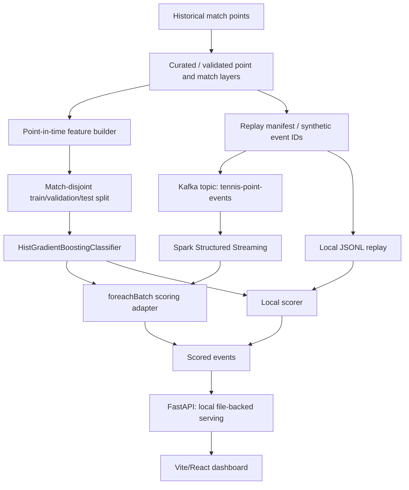

# Architecture — Centre Court Analytics

**Source:** [original team repository](https://github.com/vishaljha2121/big_data_spring_proj). This document is a portfolio case study, not executable project code.

## Data modeling and leakage controls

The training target is **whether Player A wins the current point**, using 26 prior-state features. Current-point outcomes and current numeric score fields are excluded. Match-disjoint evaluation prevents the same match appearing across splits.

The [training audit](https://github.com/vishaljha2121/big_data_spring_proj/blob/main/docs/model_training_audit.md) reports 7,355 training matches, 1,576 validation matches and 1,577 test matches; the selected model trained on 300,000 rows and was evaluated on 284,868 held-out test rows.

## Streaming

The local JSONL route is the deterministic fallback. The additional Kafka/Spark path uses a Kafka replay producer, Spark Structured Streaming with a `foreachBatch` adapter, checkpointing, and scored JSONL/Parquet sinks. The [Spark audit](https://github.com/vishaljha2121/big_data_spring_proj/blob/main/docs/spark_structured_streaming_audit.md) records a 1,000-event local run with validation status PASSED; this is not a claim of production exactly-once delivery.

## Services and UI

FastAPI serves validated local output to a React dashboard for match browsing, timelines, point prediction, replay, monitoring and model performance. No production deployment is claimed.

**Explore implementation:** [producer](https://github.com/vishaljha2121/big_data_spring_proj/tree/main/producer) · [streaming](https://github.com/vishaljha2121/big_data_spring_proj/tree/main/streaming) · [spark_streaming](https://github.com/vishaljha2121/big_data_spring_proj/tree/main/spark_streaming) · [api](https://github.com/vishaljha2121/big_data_spring_proj/tree/main/api) · [frontend](https://github.com/vishaljha2121/big_data_spring_proj/tree/main/frontend)
